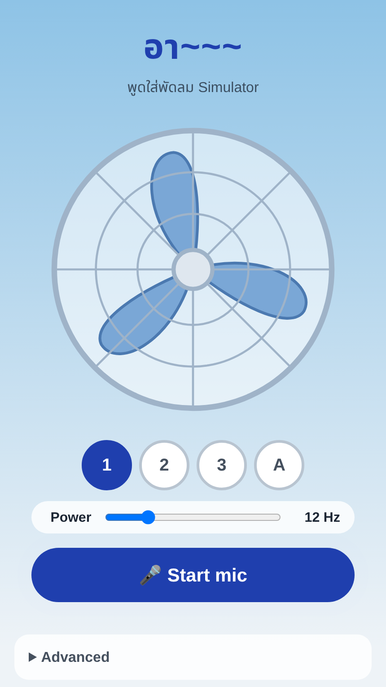

# พูดใส่พัดลม Simulator

Speak into an electric fan, in your browser. Your voice comes back chopped and wobbly - "อาาาาา~~~".

**Live:** https://fan-voice.vercel.app



## How to use

1. Select a fan speed: **1**, **2**, **3**, or **A** (auto - the speed goes up and down by itself). Use the **Power** slider for any speed between the presets.
2. Click **Start mic** and allow microphone access.
3. Talk, then stop. After a short silence, the app plays your voice back through the fan.

### Modes

| Mode | What it does |
| --- | --- |
| **Talk-back** (default) | Records when you talk, stops after 0.7 s of silence, then plays the clip back with the effect. The mic is ignored during playback, so you do not need headphones. Adjust **Threshold** if it starts too easily or not at all. |
| **Live** | Applies the effect to the mic in real time. Turn on **Live monitor** to hear it - use headphones, or the speaker feeds back into the mic. |

You can also **Record** the output, or load an **Audio file** to hear it through the fan.

## How it works

Everything runs in the browser with the [Web Audio API](https://developer.mozilla.org/en-US/docs/Web/API/Web_Audio_API). There is no server and no build step.

- **Chop** - a low-frequency oscillator (the fan speed in Hz) moves the volume up and down, like blades that cut the sound path.
- **Pitch wobble** - a short delay line that the same oscillator modulates, for a small Doppler vibrato.
- **Muffle** - a low-pass filter that opens and closes with each blade.
- **Wind noise** - band-passed white noise, also chopped by the blades.

Chop depth, pitch wobble, and wind noise are under **Advanced**.

Talk-back mode captures raw mic samples with an `AudioWorklet` and sends them to a small energy-based voice activity detector (`vad.js`). The detector keeps 0.3 s of audio before speech starts, so the first syllable is not cut, and it trims the silence at the end of the clip.

## Development

```sh
# Serve locally (the mic needs localhost or HTTPS)
python3 -m http.server 8000

# Run the voice activity detector tests
node --test
```

## Deploy

```sh
pnpm dlx vercel@latest deploy --prod --scope notnarze
```
